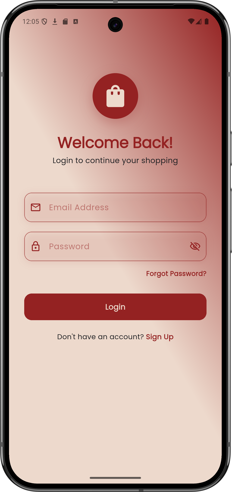
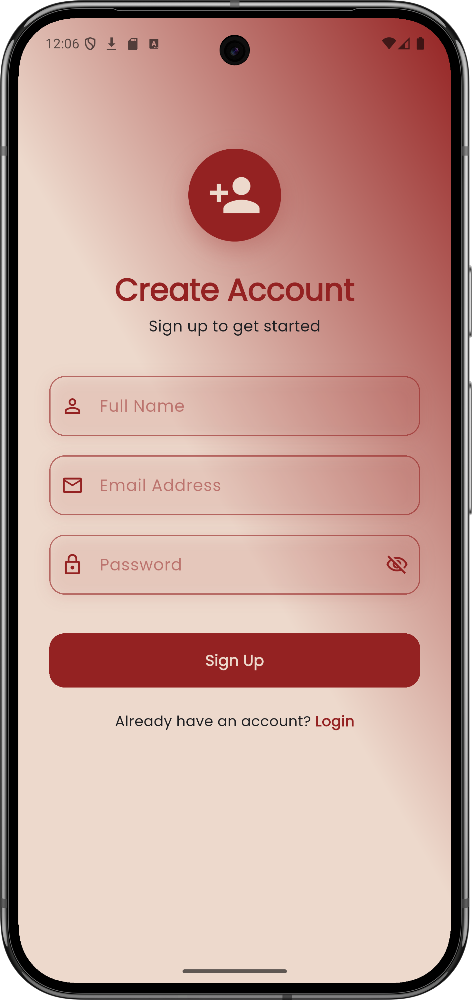
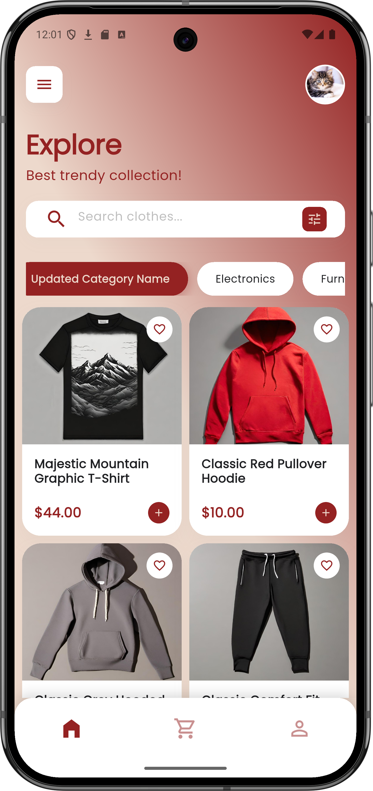
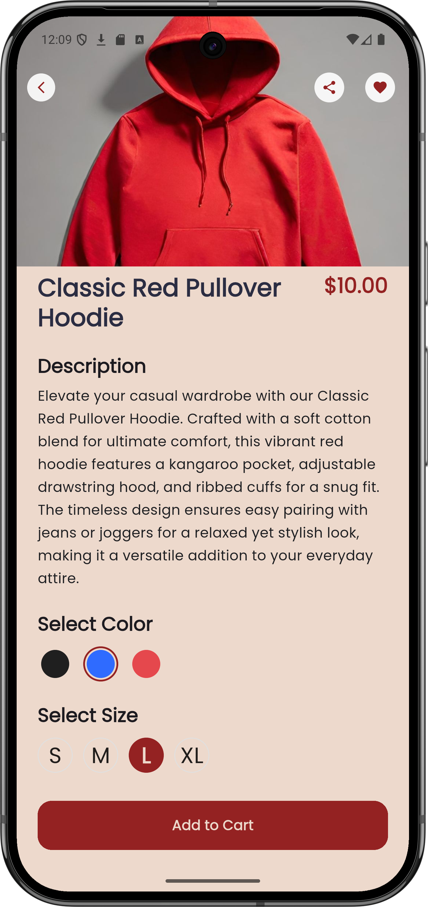
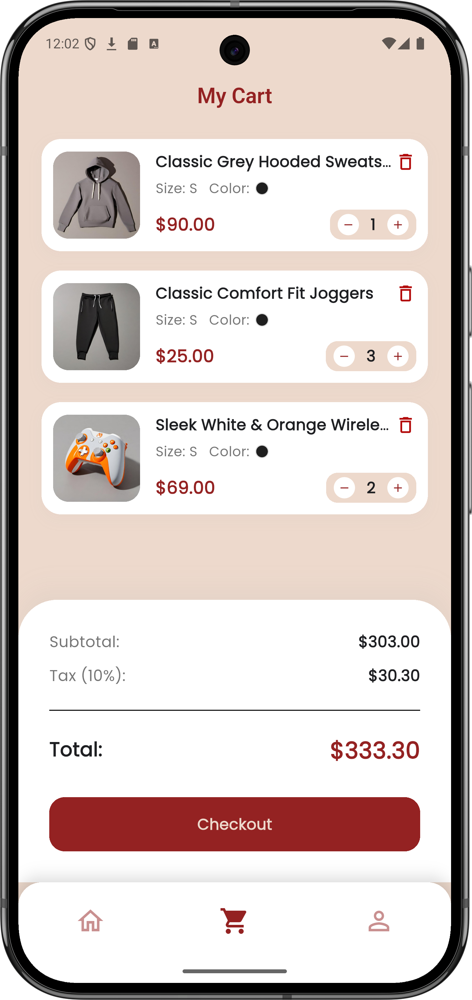
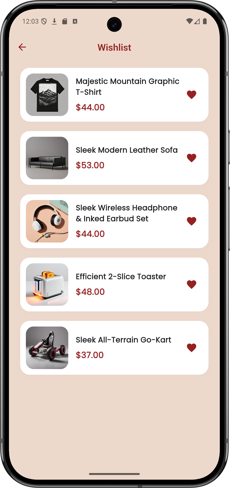
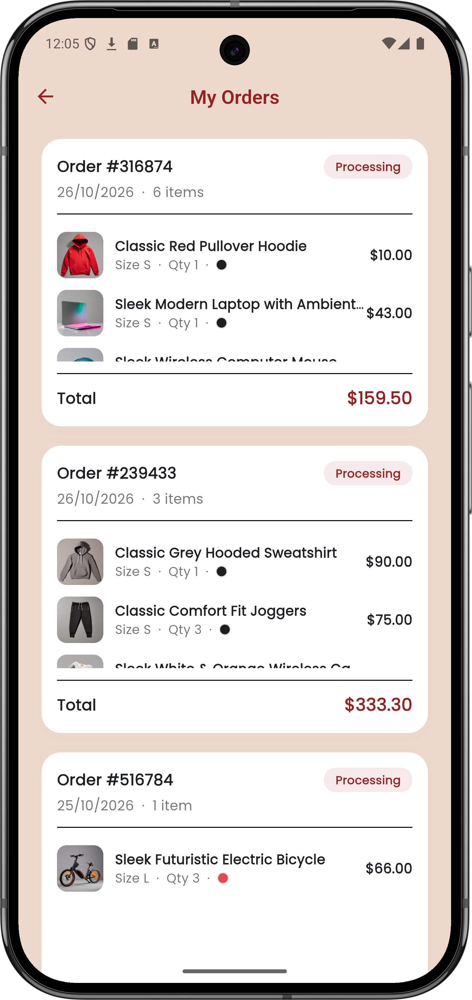
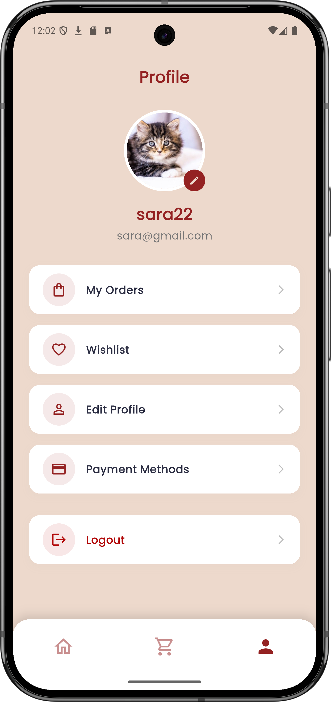
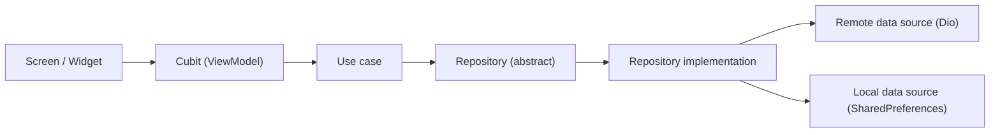

# Huma-volve — E-Commerce App

**Your Ultimate E-Commerce App.** A Flutter shopping app built with **Clean Architecture + MVVM** and **Cubit** state management.


-B20808)


---

## Table of contents

- [Screenshots](#screenshots)
- [Features](#features)
- [Tech stack](#tech-stack)
- [Architecture](#architecture)
- [API](#api)
- [How user data is stored](#how-user-data-is-stored)
- [Design](#design)
- [Getting started](#getting-started)
- [Build and deploy the web app](#build-and-deploy-the-web-app)
- [Roadmap](#roadmap)
- [Author](#author)

---

## Screenshots

<table>
  <tr>
    <td align="center"><br/><b>Login</b></td>
    <td align="center"><br/><b>Sign up</b></td>
    <td align="center"><br/><b>Home</b></td>
    <td align="center"><br/><b>Product details</b></td>
  </tr>
  <tr>
    <td align="center"><br/><b>Cart</b></td>
    <td align="center"><br/><b>Wishlist</b></td>
    <td align="center"><br/><b>My orders</b></td>
    <td align="center"><br/><b>Profile</b></td>
  </tr>
</table>


---

## Features

**Authentication**
- Sign up with name, email and password, and login with email and password, both with form validation.
- Access and refresh tokens are stored on the device. The splash screen reads them and opens the app directly for a returning user.
- Logout clears the session.

**Shopping**
- Categories and a product grid with **infinite scroll pagination** (`limit` / `offset`).
- Add to cart straight from a product card (first size and color), or choose a color and size on the details page.
- **Product details are fetched by product id**, so the page only needs an id (ready for deep links). The details page has a color selector, a size selector, an add-to-cart button, a wishlist toggle and a share button that creates a product link.
- Broken or missing product images fall back to a placeholder icon.

**Cart and checkout**
- Increase, decrease and delete items. The same product with a different size or color is a separate cart line.
- Subtotal, 10% tax and total.
- Tap any cart item to open its product page with the selected size and color already chosen.
- Checkout with shipping phone and address (prefilled from the profile), cash on delivery and a scrollable order summary.

**Orders and wishlist**
- Order history, newest first, with a fixed-size scrollable product list inside each order. Tap a product to open it with the same size and color.
- Wishlist with a heart toggle on product cards and on the details page.

**Profile**
- Name and email come from sign up, and the email is shown read-only.
- Edit name, phone and address.
- Change the profile picture from the gallery or file picker, with a default avatar until one is chosen. The picture also appears in the home header.

**Per-user data**
- Cart, wishlist, orders and profile are saved separately for each user on the device.

---

## Tech stack

| Area | Technology |
| --- | --- |
| Framework | Flutter / Dart |
| State management | `flutter_bloc` (Cubit) |
| Architecture | Clean Architecture, MVVM, feature-first folders |
| Networking | `dio` |
| Functional error handling | `dartz` (`Either<Failure, T>`) |
| Local storage | `shared_preferences`, secure token storage |
| Media and sharing | `image_picker`, `share_plus` |
| Fonts | `google_fonts` (Playfair Display, Poppins) |
| Hosting | Firebase Hosting |

---

## Architecture

The project is organised by feature. Every feature has the same three layers:

```
lib/
├── core/
│   ├── constants/        # API endpoints, product colors and sizes
│   ├── error/            # ErrorHandler: exceptions -> Failure
│   ├── failure/          # Failure model
│   ├── network/          # ApiClient (Dio)
│   ├── storage/          # SecureStorage, UserSession
│   ├── utils/            # image url cleanup
│   ├── widgets/          # shared widgets (PrimaryButton, AuthTextField, ...)
│   ├── app_providers.dart
│   └── theme.dart
└── features/
    ├── splash/
    ├── auth/
    │   ├── login/
    │   └── sign_up/
    ├── main_navigation/
    ├── home/
    ├── details/
    ├── cart/
    ├── wishlist/
    ├── orders/           # orders list + checkout
    └── profile/
```

Inside each feature:

```
feature/
├── data/
│   ├── data_source/      # remote (API) or local (SharedPreferences) data sources
│   ├── models/           # entities + fromJson / toJson
│   └── repository/       # repository implementations
├── domain/
│   ├── entities/         # plain business objects
│   ├── repository/       # abstract repositories
│   └── use_cases/        # one class per action
└── presentation/
    ├── view/             # screens and widgets
    └── view_model/       # Cubit + states
```

**Data flow**



- The domain layer does not depend on Flutter or on any data source.
- Repositories return `Either<Failure, T>`, so the UI never handles raw exceptions.
- **Shared cubits** (cart, wishlist, profile) are provided once above `MaterialApp` in `AppProviders`, so pages opened with `Navigator.push` (details, checkout) can use them too.
- The main navigation uses an `IndexedStack`, so Home keeps its state, scroll position and loaded pages when you switch tabs.

---

## API

The app uses the [Platzi Fake Store API](https://api.escuelajs.co/docs) (Swagger documentation). Endpoint paths are defined in `lib/core/constants/api_endpoints.dart`.

| Feature | Request |
| --- | --- |
| Login | `POST /auth/login` |
| Sign up | `POST /users` |
| Categories | `GET /categories` |
| Products of a category | `GET /categories/{id}/products?limit=&offset=` |
| Product details | `GET /products/{id}` |

The API has no cart, wishlist or order endpoints, so those features are stored on the device (see below).

---

## How user data is stored

Cart, wishlist, orders and profile are saved locally with `shared_preferences`. Each key includes the logged-in user's email, for example `cart_items_bob@mail.com`, so two accounts on the same device never see each other's data. After login, the shared cubits reload the new user's data.

Because the data lives on the device, it does not sync between devices. A real backend for these features is on the roadmap.

---

## Design

| Token | Value |
| --- | --- |
| Primary | `#942222` |
| Background | `#EDD9CC` |
| Cards and sheets | White |
| Headings font | Playfair Display |
| Body font | Poppins |

All colors live in `lib/core/theme.dart`, together with the diagonal gradient used on the login, sign up and home screens.

---

## Getting started

**Prerequisites**
- Flutter 3.27 or newer (Dart 3.6 or newer)
- Chrome, if you want to run the web version
- For iOS, add `NSPhotoLibraryUsageDescription` to `ios/Runner/Info.plist` (needed by the image picker)

**Run**

```bash
git clone https://github.com/yar-eh/Ecommerce-Huma-volve.git
cd Ecommerce-Huma-volve
flutter pub get
flutter run              # connected device or emulator
flutter run -d chrome    # web
```
---

## future Roadmap

- [ ] Working search and filters on the home screen
- [ ] Backend for cart, wishlist and orders, so data syncs across devices
- [ ] Payment methods
- [ ] Settings page
- [ ] Unit and widget tests

---
